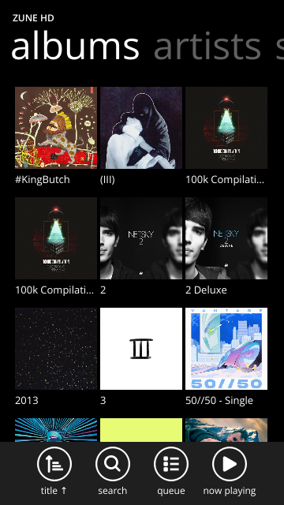
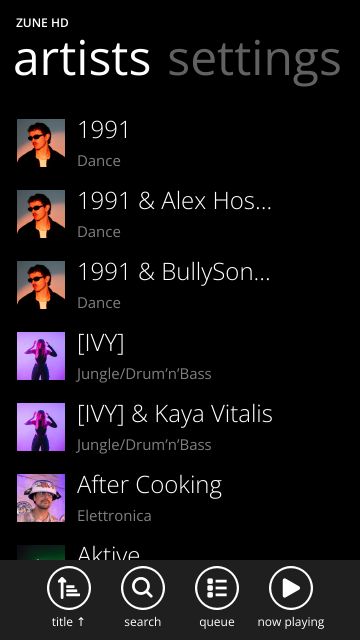
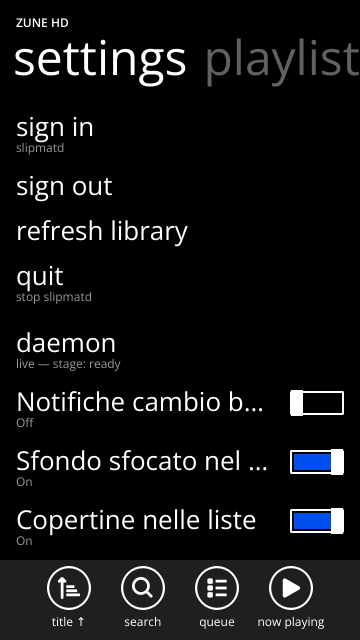

# ztOS-Zune — a Zune HD style music player for ztOS

**English** · [Italiano](#italiano)

<p align="center">
  
  
  
</p>

A music app for [ztOS](https://github.com/Zerone-Laboratories/ztOS) (the
ztMETRO phone shell), written with the official ztOS SDK: Python + Qt Widgets,
no QML. It looks and moves like the Zune HD: big light titles, a panorama
pivot (playlists / songs / albums / artists / settings), full-bleed artist,
album and playlist pages.

It is a **client of [Slipmat](https://github.com/SoftARV/Slipmat)'s daemon
`slipmatd`** (Apple Music for Linux): Slipmat does the sign-in, the library and
the playback; this app is only the touch interface, talking to the daemon's
Unix socket. This repository is a fork of Slipmat and the app lives on the
`ztOS-Zune` branch.

> Unofficial. Not affiliated with or endorsed by Apple, Microsoft, Slipmat's
> author or the ztOS project. "Zune" is a Microsoft trademark, used here only
> to describe the look this app imitates; no Microsoft font, image or code is
> included (see [PROVENANCE.md](PROVENANCE.md)).

## Features

- Library pivot: playlists, songs, albums (grid or list), artists; sort per
  section; refresh the library from Settings.
- Full-bleed hero pages for artists, albums and playlists; "view artist" from
  an album; saved artists open the full catalog profile.
- Search grouped by category (artists, albums, songs, playlists) with filter
  chips.
- Now playing: cover, seek bar, transport, optional blurred background, live
  tile on the home screen.
- Queue with a real drag handle (reorder), tap to jump, hold to remove.
- Song context menu: play next, add to queue, favourite, add to / remove from
  library.
- Tracks Apple cannot stream are shown dimmed with a clear message, never
  skipped silently.
- Settings: covers on/off (no thumbnails, no downloads), albums as list,
  blurred player background, track-change notifications, sign in/out.
- Tuned for a slow phone (OnePlus 2, 4× Cortex-A53): cached rows, cover
  downloads paused while you scroll, a priority fetch queue for what is on
  screen.

## What it needs

- A ztOS phone (or the SDK's 360×640 desktop window for development).
- `slipmatd` from [Slipmat](https://github.com/SoftARV/Slipmat) (0.12.x),
  signed in to Apple Music. If the daemon is not running or not signed in,
  the app shows empty pages with a notice saying why.
- What the daemon does not offer is not here either: videos, radio, similar
  artists.

## Build and run

The ztOS SDK is not vendored. Copy it next to the app (it is git-ignored):

```sh
git clone https://github.com/Zerone-Laboratories/ztOS /tmp/ztOS
mkdir -p .sdk/ztos/ztmetro/core
cp -r /tmp/ztOS/sdk .sdk/ztos/
cp /tmp/ztOS/ztmetro/core/zrnmetrorender.h .sdk/ztos/ztmetro/core/

python3 .sdk/ztos/sdk/bin/ztos-sdk run      # 360x640 window on the PC
python3 .sdk/ztos/sdk/bin/ztos-sdk build    # dist/dev.oneplus2.zunehd (aarch64)
```

Install on the phone: see [INSTALL.md](INSTALL.md) (Italian). The app id is
`dev.oneplus2.zunehd`; the manifest is [ztos.toml](ztos.toml).

## Tests

Offscreen Qt tests against a fake `slipmatd` (`tests/fake_slipmatd.py`):

```sh
env -i HOME=$HOME PATH=/usr/bin:/bin QT_QPA_PLATFORM=offscreen \
    python3 -u tests/test_client.py
```

Same for `test_hero.py`, `test_search.py`, `test_warm.py`, `test_buttons.py`,
`test_art.py`, `test_nav.py`, `test_player.py`, …

## Layout

| File | What |
|---|---|
| `main.py` | entry point, perf hooks |
| `hub.py` | pivot, lists, album grid, hero, detail pages |
| `screens.py` | search, queue, settings |
| `player.py` | now playing |
| `client.py`, `slipmat/ipc.py` | `slipmatd` socket client |
| `art.py`, `widgets.py` | cover cache/fetch, rows and buttons |
| `IPC.md` | the daemon protocol as read from its source |
| `DESIGN.md`, `FEATURES-PARITY.md`, `STATO.md` | design notes, parity with Slipmat's own UI, work log (Italian) |

## Known limits

- Smoothness on the OnePlus 2 depends on the GPU/kernel state of the phone: a
  long uptime on one kernel build produced GPU submit failures (visible as
  scroll glitches) that went away after a reboot. Measurements are in
  [PERF-ON-B.md](PERF-ON-B.md) and [STATO.md](STATO.md).
- Unplayable tracks follow what the daemon reports.

## License and credits

GPL-3.0-or-later, see [COPYING](COPYING). The protocol client reimplements
Slipmat's IPC (GPL-3.0-or-later, © Miguel Rincon); the ztOS SDK is
GPL-3.0-or-later. Icons are GNOME Adwaita symbolic icons. Details in
[PROVENANCE.md](PROVENANCE.md).

## Acknowledgements

- **[Zerone Laboratories](https://github.com/Zerone-Laboratories/ztOS)** for
  ztOS, the ztMETRO shell and the SDK this app is built with.
- **[Slipmat](https://github.com/SoftARV/Slipmat)** by Miguel Rincon for
  everything else: the `slipmatd` daemon, the protocol, the Apple Music
  sign-in, the library and the playback.
- **[zune-player](https://github.com/bransonwerner/zune-player)** by Branson
  Werner, the Zune HD web demo where the design started. We only observed how
  it looks while running; none of its code or assets is in this repository.

---

<a id="italiano"></a>

# ztOS-Zune — un lettore musicale in stile Zune HD per ztOS

[English](#ztos-zune--a-zune-hd-style-music-player-for-ztos) · **Italiano**

App musicale per [ztOS](https://github.com/Zerone-Laboratories/ztOS) (la shell
per telefono ztMETRO), scritta con l'SDK ufficiale di ztOS: Python + Qt
Widgets, niente QML. Ha l'aspetto e il movimento dello Zune HD: titoli grandi
e leggeri, pivot a panorama (playlist / brani / album / artisti /
impostazioni), pagine di artista, album e playlist a tutta larghezza.

È un **client del demone `slipmatd` di [Slipmat](https://github.com/SoftARV/Slipmat)**
(Apple Music per Linux): Slipmat gestisce accesso, libreria e riproduzione;
questa app è solo l'interfaccia touch, e parla col socket Unix del demone.
Questo repository è un fork di Slipmat e l'app sta nel branch `ztOS-Zune`.

> Non ufficiale. Nessun legame con Apple, Microsoft, l'autore di Slipmat o il
> progetto ztOS. "Zune" è un marchio Microsoft, usato solo per descrivere
> l'aspetto imitato; non c'è alcun font, immagine o codice Microsoft (vedi
> [PROVENANCE.md](PROVENANCE.md)).

## Funzioni

- Pivot della libreria: playlist, brani, album (griglia o lista), artisti;
  ordinamento per sezione; aggiornamento della libreria dalle Impostazioni.
- Pagine "hero" a tutta larghezza per artisti, album e playlist; "view artist"
  dall'album; gli artisti salvati aprono il profilo completo del catalogo.
- Ricerca raggruppata per categoria (artisti, album, brani, playlist) con
  filtri visibili.
- In riproduzione: copertina, barra di avanzamento, comandi, sfondo sfocato
  opzionale, tile live nella home.
- Coda con maniglia di trascinamento vera (riordino), tocco per saltare,
  pressione lunga per rimuovere.
- Menu del brano: riproduci dopo, aggiungi alla coda, preferito,
  aggiungi/rimuovi dalla libreria.
- I brani che Apple non permette in streaming sono mostrati attenuati con un
  messaggio chiaro, mai saltati in silenzio.
- Impostazioni: copertine on/off (niente miniature e niente download), album
  in lista, sfondo sfocato del player, notifiche di cambio brano, accesso /
  uscita.
- Pensata per un telefono lento (OnePlus 2, 4× Cortex-A53): righe in cache,
  download delle copertine in pausa mentre scorri, coda di download con
  priorità per ciò che è a schermo.

## Cosa serve

- Un telefono con ztOS (oppure la finestra desktop 360×640 dell'SDK per
  sviluppare).
- `slipmatd` di [Slipmat](https://github.com/SoftARV/Slipmat) (0.12.x), con
  accesso ad Apple Music già fatto. Se il demone non è attivo o non ha fatto
  l'accesso, l'app mostra pagine vuote con un avviso che ne spiega il motivo.
- Quello che il demone non offre non c'è nemmeno qui: video, radio, artisti
  simili.

## Compilare ed eseguire

L'SDK di ztOS non è incluso. Copialo accanto all'app (è in `.gitignore`):

```sh
git clone https://github.com/Zerone-Laboratories/ztOS /tmp/ztOS
mkdir -p .sdk/ztos/ztmetro/core
cp -r /tmp/ztOS/sdk .sdk/ztos/
cp /tmp/ztOS/ztmetro/core/zrnmetrorender.h .sdk/ztos/ztmetro/core/

python3 .sdk/ztos/sdk/bin/ztos-sdk run      # finestra 360x640 sul PC
python3 .sdk/ztos/sdk/bin/ztos-sdk build    # dist/dev.oneplus2.zunehd (aarch64)
```

Installazione sul telefono: vedi [INSTALL.md](INSTALL.md) (in italiano). L'id
dell'app è `dev.oneplus2.zunehd`; il manifesto è [ztos.toml](ztos.toml).

## Test

Test Qt offscreen contro un `slipmatd` finto (`tests/fake_slipmatd.py`):

```sh
env -i HOME=$HOME PATH=/usr/bin:/bin QT_QPA_PLATFORM=offscreen \
    python3 -u tests/test_client.py
```

Lo stesso per `test_hero.py`, `test_search.py`, `test_warm.py`,
`test_buttons.py`, `test_art.py`, `test_nav.py`, `test_player.py`, …

## Struttura

| File | Cosa |
|---|---|
| `main.py` | punto d'ingresso, strumenti di misura |
| `hub.py` | pivot, liste, griglia album, hero, pagine di dettaglio |
| `screens.py` | ricerca, coda, impostazioni |
| `player.py` | in riproduzione |
| `client.py`, `slipmat/ipc.py` | client del socket di `slipmatd` |
| `art.py`, `widgets.py` | cache/download copertine, righe e pulsanti |
| `IPC.md` | il protocollo del demone, come letto dal suo sorgente |
| `DESIGN.md`, `FEATURES-PARITY.md`, `STATO.md` | note di design, parità con la UI di Slipmat, diario di lavoro (in italiano) |

## Limiti noti

- La fluidità sul OnePlus 2 dipende dallo stato di GPU/kernel del telefono:
  una lunga accensione con una certa build del kernel ha prodotto errori di
  invio alla GPU (visibili come scatti nello scorrimento) spariti dopo un
  riavvio. Le misure sono in [PERF-ON-B.md](PERF-ON-B.md) e [STATO.md](STATO.md).
- I brani non riproducibili seguono ciò che segnala il demone.

## Licenza e crediti

GPL-3.0-or-later, vedi [COPYING](COPYING). Il client del protocollo
reimplementa l'IPC di Slipmat (GPL-3.0-or-later, © Miguel Rincon); l'SDK di
ztOS è GPL-3.0-or-later. Le icone sono le icone symbolic di GNOME Adwaita.
Dettagli in [PROVENANCE.md](PROVENANCE.md).

## Ringraziamenti

- **[Zerone Laboratories](https://github.com/Zerone-Laboratories/ztOS)** per
  ztOS, la shell ztMETRO e l'SDK con cui è fatta l'app.
- **[Slipmat](https://github.com/SoftARV/Slipmat)** di Miguel Rincon per tutto
  il resto: il demone `slipmatd`, il protocollo, l'accesso ad Apple Music, la
  libreria e la riproduzione.
- **[zune-player](https://github.com/bransonwerner/zune-player)** di Branson
  Werner, la demo web dello Zune HD da cui è partito il design. Ne abbiamo
  solo osservato l'aspetto in esecuzione; nessun suo codice o asset è in
  questo repository.
